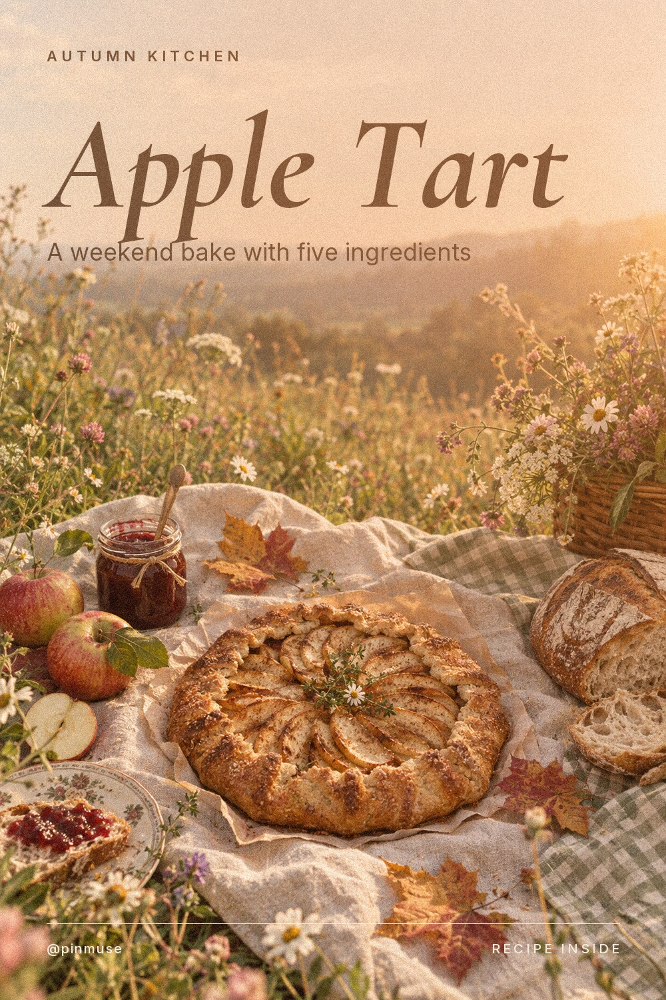
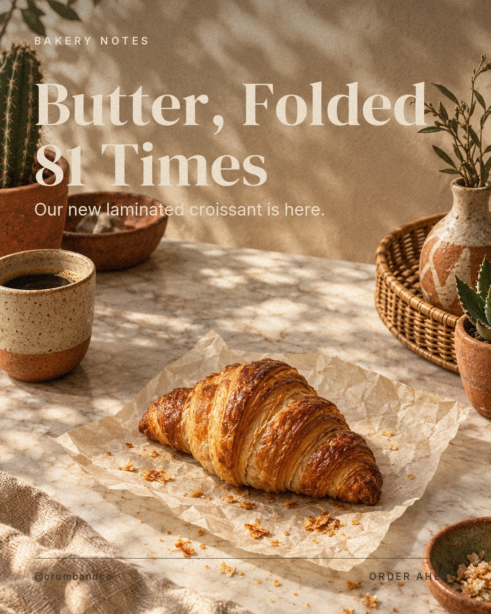
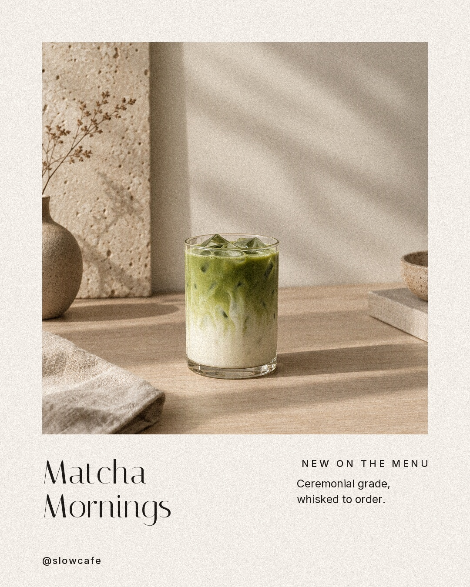
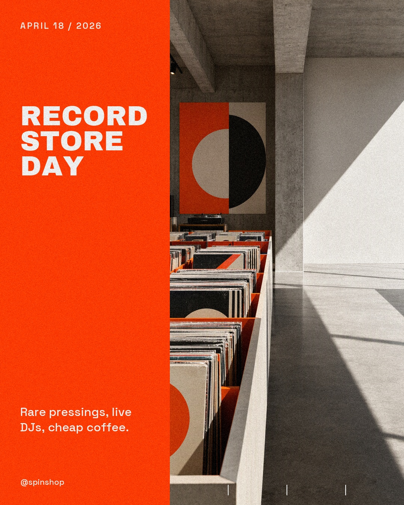
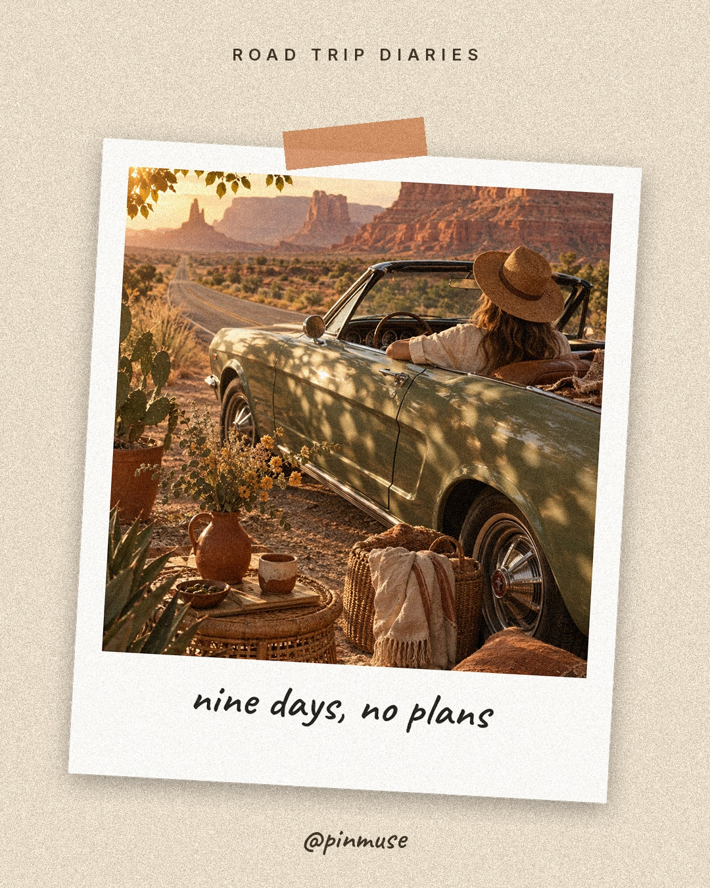

<div align="center">


# pinmuse

**An open-source AI design agent that studies Pinterest and makes the post.**

Posters, Instagram stories, carousels and pins with real typography, from one sentence.<br>
Agent Skill, CLI and MCP server for Claude Code, Codex, Gemini CLI and any MCP client.

[](https://github.com/prantikmedhi/pinmuse/actions/workflows/ci.yml)
[](LICENSE)
[](pyproject.toml)
[](src/pinmuse/mcp_server.py)

[Website](https://pinmuse.vercel.app) · [Gallery](#gallery) · [Install](#install) · [Usage](#usage) · [Image models](#image-models) · [FAQ](#faq)

</div>

---

You ask your agent for *"a dark-academia story for my book club"*. pinmuse searches Pinterest, reads the palette, light and mood of the pins it finds, writes an image prompt that leaves room for type, generates the picture with whatever model you have, and sets the headline itself. You get a finished file, a caption with hashtags, and credits for the pins it learned from.

No screenshots, no copy-pasting pins, no design app.

## Gallery

Each design is a single `pinmuse create` command. Images by `gpt-image-2.5-flare`; layout and type by pinmuse.

<table>
<tr>
<td width="25%"></td>
<td width="25%"></td>
<td width="25%"></td>
<td width="25%"></td>
</tr>
<tr>
<td></td>
<td></td>
<td></td>
<td></td>
</tr>
<tr>
<td></td>
<td></td>
<td></td>
<td></td>
</tr>
<tr>
<td></td>
<td></td>
<td></td>
<td></td>
</tr>
</table>

Carousels come out as a cover, numbered slides and an end card:

<p>


</p>

The raw generations underneath each design are in [`outputs/photos`](outputs/photos). More on the [website](https://pinmuse.vercel.app).

## Install

```bash
curl -fsSL https://raw.githubusercontent.com/prantikmedhi/pinmuse/main/install.sh | bash
```

This installs the CLI and links the skill into every agent it finds (Claude Code, Codex, Gemini CLI, Antigravity, opencode, OpenClaw, Hermes, Cursor). Add `--mcp` to register the MCP server too.

<details>
<summary>Manual install per agent</summary>

| Agent | Skill | MCP |
|---|---|---|
| Claude Code | `/plugin marketplace add prantikmedhi/pinmuse` → `/plugin install pinmuse` | included |
| Codex | `ln -s $PWD/skills/pinmuse ~/.codex/skills/pinmuse` | `codex mcp add pinmuse -- pinmuse mcp` |
| Gemini CLI | `gemini extensions install https://github.com/prantikmedhi/pinmuse` | included |
| Antigravity | `ln -s $PWD/skills/pinmuse ~/.gemini/antigravity/skills/pinmuse` | `pinmuse mcp` |
| opencode | `ln -s $PWD/skills/pinmuse ~/.config/opencode/skills/pinmuse` | `{"type": "local", "command": ["pinmuse", "mcp"]}` |
| OpenClaw / Hermes | `ln -s $PWD/skills/pinmuse ~/.openclaw/skills/pinmuse` | `pinmuse mcp` |
| Any MCP client | n/a | copy [`.mcp.json`](.mcp.json) |

CLI only: `pip install "pinmuse[mcp] @ git+https://github.com/prantikmedhi/pinmuse"`
</details>

## Usage

Ask your agent:

> Make an Instagram story for our Friday rooftop party. Get the vibe from Pinterest: vaporwave sunset.

Or run it yourself:

```bash
pinmuse create "rooftop party at sunset" --inspo "vaporwave sunset aesthetic" \
  -t story -f ig-story --title "Sunset Club" --subtitle "Friday • rooftop • 8pm" --cta "RSVP in bio"
```

```text
pinmuse-out/20261103-201500-sunset-club/
├── story-ig-story.jpg   the post
├── base-1.png           the generated image
├── moodboard.jpg        the pins it learned from
├── caption.txt          caption and hashtags
└── manifest.json        prompt, palette, model, pin credits
```

Step by step, the way the skill teaches agents to work:

```bash
pinmuse suggest   "cozy reading"                 # Pinterest's own related searches
pinmuse moodboard "dark academia library"        # palette, mood, aesthetic, contact sheet
pinmuse generate  "<prompt>" -f ig-post --refs pin1.jpg,pin2.jpg
pinmuse compose   -t quote -f ig-post --image generated.png --title "Paradise is a kind of library."
```

## How it works

1. **Explore** Pinterest by phrase, pin URL or board URL, signed out and throttled. The official API covers your private boards.
2. **Distill** the palette, brightness, contrast, warmth and recurring motifs, and match them against 14 aesthetics. The agent also looks at a contact sheet.
3. **Prompt** for the subject and the learned direction, with empty space where the text will go. The model never draws text.
4. **Generate** with your model. OpenAI and Gemini can take 2–4 pins as style references.
5. **Compose** with real fonts, auto-fit, safe zones, grain and your brand kit.
6. **Ship** the post plus `caption.txt` and `manifest.json` with pin credits.

## Image models

`--provider auto` uses the first one configured. `pinmuse list providers` shows what is set up.

| Provider | Setup |
|---|---|
| OpenAI gpt-image | `OPENAI_API_KEY`, optional `PINMUSE_OPENAI_MODEL` |
| Azure OpenAI | `OPENAI_BASE_URL=https://<resource>.openai.azure.com/openai/v1`, `OPENAI_API_KEY`, `PINMUSE_OPENAI_MODEL=<deployment>` |
| Gemini (Nano Banana) | `GEMINI_API_KEY` |
| Flux on fal / Replicate / Together | `FAL_KEY` / `REPLICATE_API_TOKEN` / `TOGETHER_API_KEY` |
| Stability | `STABILITY_API_KEY` |
| ComfyUI, AUTOMATIC1111, Forge | running locally on the default port |
| 🤗 diffusers | `pip install "pinmuse[local]"` |
| Any CLI | `PINMUSE_IMAGE_CMD='mflux-generate --prompt {prompt} --output {out}'` |
| None | built-in `procedural` backgrounds, no key needed |

If your agent already has an image tool, it can generate there and run `pinmuse compose --image` on the result.

## Templates and formats

**Templates** `poster` `magazine` `story` `quote` `polaroid` `minimal` `swiss` `collage` `palette` `carousel`

**Formats** Instagram post, square, story and reel cover · Pinterest pin and long pin · X · LinkedIn · YouTube thumbnail · Facebook cover · A3 and 18×24 posters · wallpapers · any `WIDTHxHEIGHT`

**Aesthetics** minimal luxe, dark academia, clean girl, Y2K, cottagecore, cyberpunk neon, coastal summer, brutalist, old money, vaporwave, moody film, pastel dream, earthy boho, gothic romance ([guide](skills/pinmuse/references/aesthetics.md))

**Brand kit** `--brand brand.json` with your handle, palette, fonts and logo.

<details>
<summary>CLI, MCP tools and configuration</summary>

| Command | |
|---|---|
| `pinmuse search <query \| pin url \| board url>` | pins as JSON |
| `pinmuse suggest <idea>` | related searches |
| `pinmuse moodboard <query>` | palette, metrics, aesthetic, contact sheet |
| `pinmuse prompt <subject> --moodboard m.json` | image prompt |
| `pinmuse generate <prompt>` | image from the best provider |
| `pinmuse compose -t <template> --image …` | lay out a design |
| `pinmuse create <subject> --inspo <query>` | the whole pipeline |
| `pinmuse boards` | your boards (official API) |
| `pinmuse list providers\|aesthetics\|formats\|templates` | options |
| `pinmuse mcp` | MCP server over stdio |

Every command prints JSON; errors are `{"ok": false, "error": …}`.

**MCP tools** `pinterest_search` `pinterest_suggest` `pinterest_moodboard` `build_prompt` `generate_image` `compose_design` `create_design` `list_options`

| Variable | Default | |
|---|---|---|
| `PINMUSE_PROVIDER` | `auto` | force a provider |
| `PINMUSE_OUT` | `./pinmuse-out` | output folder |
| `PINMUSE_CACHE` | `~/.cache/pinmuse` | pin cache |
| `PINMUSE_MIN_INTERVAL` | `0.8` | seconds between Pinterest requests |
| `PINTEREST_ACCESS_TOKEN` | | official API |

Settings can also live in `~/.config/pinmuse/config.json`.
</details>

## FAQ

**Is reading Pinterest allowed?** pinmuse reads public pages signed out, cached and throttled to human volume, and never asks for your password. Use the official API for private boards, and check Pinterest's terms for commercial use.

**Will it copy someone's pin?** No. Pins set the direction: palette, light, composition. The skill forbids reproducing pins, people, logos or watermarks, and every `manifest.json` credits the pins used.

**Do I need an API key?** No. Without one you get typographic designs on procedural backgrounds. A gpt-image, Gemini or Flux key gives photographic results like the gallery.

**Which platforms?** Instagram, Pinterest, TikTok covers, X, LinkedIn, YouTube, Facebook and print.

## Contributing

```bash
git clone https://github.com/prantikmedhi/pinmuse && cd pinmuse
pip install -e ".[dev,mcp]" && pytest -q
```

New aesthetics, templates and providers are welcome. See [CONTRIBUTING.md](CONTRIBUTING.md).

<sub>MIT © Prantik Medhi · Fonts under the SIL Open Font License · Not affiliated with Pinterest.</sub>
